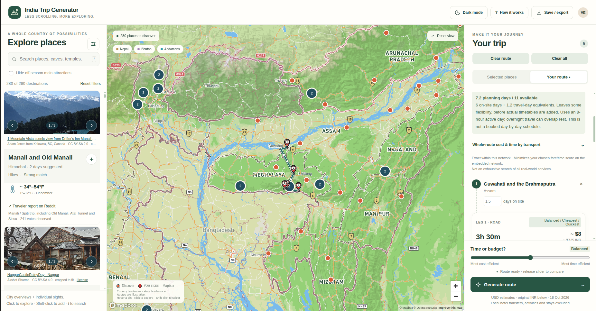

# India Trip Generator

Interactive planner for building India (and nearby) itineraries: browse 280 destinations with photos and climate bands, pin stops on a Mapbox map, then generate a cost/time-aware route.

- Read **README_HUMAN.md** to use the planner and build the single downloadable page.
- Read **README_AGENT.md** for architecture, interaction rules, tests and source packaging.

Build: `python build.py` → `dist/India_Trip_Generator.html`.

Copy `config/mapbox.example.json` → `config/mapbox.public.json` (or set `MAPBOX_TOKEN`) before building. Tokens and `dist/` are gitignored.
